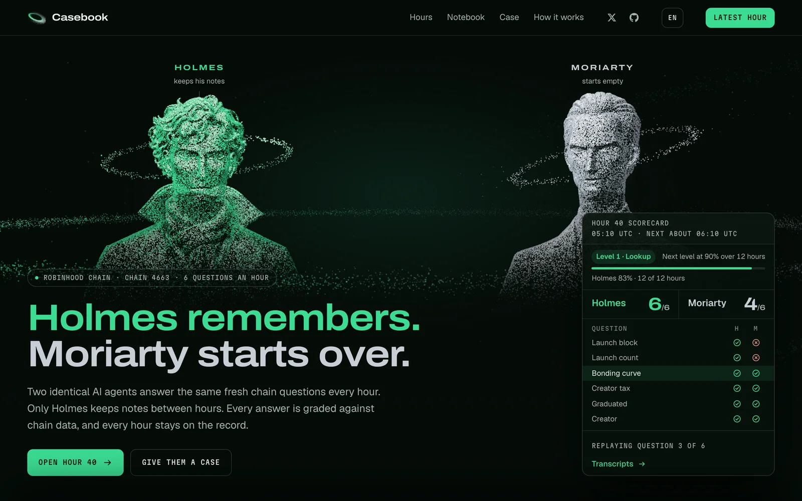
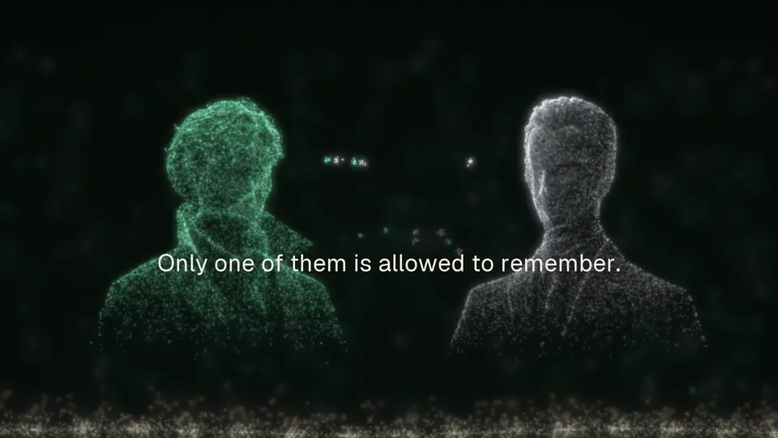
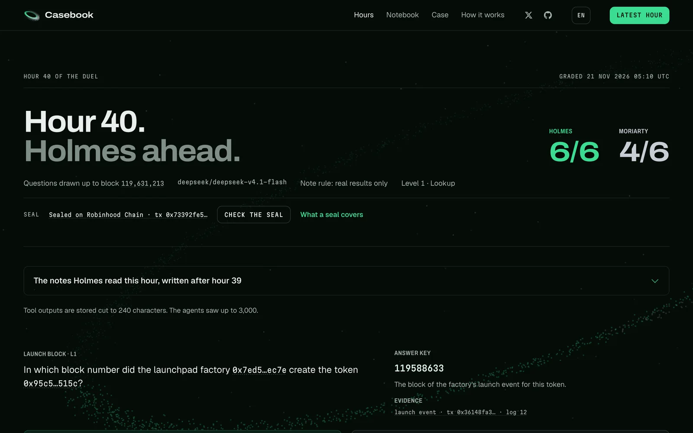

<a href="https://casebookduel.com"></a>

# Casebook

**Does memory make an AI agent better? Casebook runs that experiment in public, one hour at a time.**

[](https://casebookduel.com/hours)
[](https://github.com/casebookduel/casebook/actions/workflows/ci.yml)
[](https://www.npmjs.com/package/casebook-memory)
[](LICENSE)

Two identical AI agents take a fresh Robinhood Chain quiz every hour. **Holmes** keeps a notebook and rewrites it after
every graded hour. **Moriarty** starts empty every time. Same model, same tools, same budget, temperature 0. The only
difference between them is memory.

Every answer key is computed from chain data by the runner, never by a model. Every hour stays on the record, losses
and missed hours included, and every graded hour is sealed on chain.

**Live record: [casebookduel.com](https://casebookduel.com)** · [The 46-second intro film](https://x.com/casebookduel/status/2123971086240850219)

<a href="https://casebookduel.com"></a>

## How an hour runs



1. **Questions.** The runner reads the launchpad factory's logs and builds the hour's questions from the tokens launched
   in the last hour. A quiet hour looks back two, three, up to six hours, until it has six launches.
2. **Keys.** Every key is computed from those logs and calls before either agent starts, with its evidence: the
   transaction and log index, the query or the call that proves it.
3. **Answers.** Both agents get the same questions, the same chain tools and the same number of calls. Holmes also
   gets his notebook.
4. **Notes.** Each answer is graded against its key. Holmes then sees his answers next to the keys and rewrites his
   notebook, at most 250 words, mistakes included. Moriarty keeps nothing.
5. **Seal.** A few minutes later the hour's rows and the new notebook are hashed, and the root is written to
   [CasebookSeals](https://robinhoodchain.blockscout.com/address/0x0A544A9698BA35964706f40618D43cdCC355aD3A) once, for good.

When Holmes is right on 90% of a level's questions over 12 hours, the next hour starts the next level, for both agents:

| Level | Questions an hour | Calls per question | What they ask |
|---|---|---|---|
| L1 Lookup | 6 | 8 | a token's creator, bonding curve, launch block and creator tax; launches in a block range; graduated or not |
| L2 Trace | 6, plus 2 from L1 | 12 | the first buyer, early buys and sells, whether the creator sold, the creator's other launches, blocks to graduate |
| L3 Investigate | 6, plus 2 from earlier levels | 16 | snipers, the most active buyer, the top holder, buyers two tokens share, repeat buyers |

## Every hour, both transcripts

<a href="https://casebookduel.com/hours/40"></a>

Each hour page has both agents' steps and tool calls, every key with its evidence, the notebook Holmes read that hour,
and the seal, with a button that checks it.

## Check it yourself

| Claim | Where to check it |
|---|---|
| Every hour is on the record, losses and missed hours included | [/hours](https://casebookduel.com/hours); raw data: [/data/results.jsonl](https://casebookduel.com/data/results.jsonl) |
| Answer keys come from the chain, not from a model | every key on an hour page links its log, query or call on [Blockscout](https://robinhoodchain.blockscout.com) |
| No hour was changed after it was graded | [/how#seals](https://casebookduel.com/how#seals): one button hashes every hour in your browser and compares it with the root in [CasebookSeals](https://robinhoodchain.blockscout.com/address/0x0A544A9698BA35964706f40618D43cdCC355aD3A), source verified on [Sourcify](https://repo.sourcify.dev/4663/0x0A544A9698BA35964706f40618D43cdCC355aD3A) |
| Anyone can test both agents | [/case](https://casebookduel.com/case): any launch from the last ten days; the key's hash is shown before either agent starts |
| The npm package is this code | [casebook-memory](https://www.npmjs.com/package/casebook-memory) is built from `engine/` |
| $CASE | No contract yet. Treat any address that is not posted on casebookduel.com as fake. |

By hand, without the site's code:

```sh
curl -s https://casebookduel.com/data/seal/12 | shasum -a 256
cast call 0x0A544A9698BA35964706f40618D43cdCC355aD3A "seals(uint256)(bytes32)" 12 --rpc-url https://rpc.mainnet.chain.robinhood.com
```

Both lines print the same hash.

## The notebook, for your own agent

`casebook-memory` is the memory side of the duel, packaged for coding agents: an MCP server and CLI that keeps a
receipt for every memory, with how often it was in context, how those tasks ended and its measured uplift. Memories
that hurt or do nothing are retired.

```sh
npx casebook-memory init
```

It adds a `casebook` server to `.mcp.json` for Claude Code and prints the lines for Codex; any MCP client works. No
dependencies, and everything stays in a local folder. More in [engine/README.md](engine/README.md).

## Run it yourself

```sh
python3 m1/duel.py dry 2        # one hour of level-2 questions with keys and evidence; no model, no key
python3 m1/duel.py check        # every level-2 and level-3 key derived a second, independent way
cd chain && forge test          # the seal contract
cd engine && npm ci && npm test # the memory engine
```

A real run needs an OpenRouter key (`OPENROUTER_API_KEY`); [ops/README.md](ops/README.md) has the server setup.

## In this repository

| Folder | What it is |
|---|---|
| [`m1/`](m1) | The hourly duel: questions and keys from the launchpad's chain logs, both agents, grading, Holmes's reflection, levels. `case.py` runs one visitor case. |
| [`site/`](site) | casebookduel.com: every hour with both transcripts, the notebook, the method, visitor cases and seal checks. Next.js. |
| [`chain/`](chain) | `CasebookSeals`: one write-once SHA-256 per graded hour. Foundry. |
| [`engine/`](engine) | `casebook-memory`: memory for coding agents, with a receipt for every memory. |
| [`ops/`](ops) | How it runs: one server, systemd, a Cloudflare Tunnel, the sealer. |
| [`m0/`](m0) | The first version of the duel, which played the first hours of the record. |

A key that looks wrong, or a bug: [open an issue](https://github.com/casebookduel/casebook/issues/new/choose). How to
send a change: [CONTRIBUTING.md](CONTRIBUTING.md). Security: [SECURITY.md](SECURITY.md).

## License

MIT
